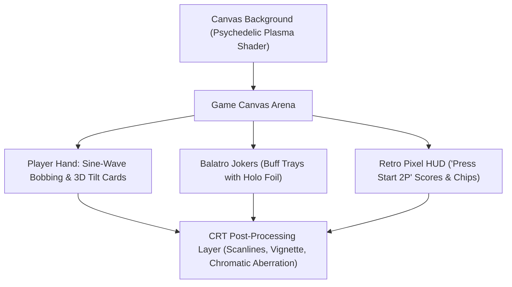

# Feature Specification: Balatro Psychedelic Retro CRT Punk Aesthetic Overhaul

## 1. Context & Objectives
- **Bối cảnh:** Giao diện hiện tại của TLMN Activity đang mang phong cách sòng bạc cổ điển (Casino Felt). Để mang lại trải nghiệm đột phá, độc đáo và cực kỳ gây nghiện, toàn bộ visual theme sẽ được chuyển đổi sang phong cách **"Balatro"** — hiện tượng game thẻ bài roguelike đình đám thế giới với thẩm mỹ:
  - Nền ảo giác chuyển động (Psychedelic fluid plasma/sine-wave shader).
  - Màn hình máy tính CRT cổ điển (Scanlines, CRT flicker, Chromatic Aberration / RGB split, Vignette bo cong viền).
  - Chuyển động thẻ bài "mọng nước" (Juicy physics: idle floating bob, 3D cursor tilt on hover, snappy mechanical card ticks).
  - Font chữ Pixel Retro 8-bit ('Press Start 2P') và hiệu ứng số nhảy rung nảy (Scale-spring number pop / jiggle).
  - Hệ thống Buff thiết kế theo phong cách thẻ bài Joker / Tarot huyền ảo với quầng sáng Holo Foil.
- **Mục tiêu:**
  - Lột xác 100% giao diện sang Balatro CRT Punk Aesthetic.
  - Bảo toàn 100% logic trò chơi, state machine, và giao thức WebSocket kết nối server.
  - Tối ưu 60 FPS, Canvas shader nhẹ nhàng mượt mà, không phụ thuộc asset ngoài.

---

## 2. User Stories & Flow

### 2.1 User Story
- **Là một người chơi**, tôi muốn trải nghiệm một bàn đấu Tiến Lên mang đậm chất hoài niệm retro pha lẫn ảo giác ma mị của Balatro, nơi màn hình rung nhẹ với tia quét CRT, thẻ bài bồng bềnh lượn sóng và các điểm số / chip nổ nảy tung tăng khi có combo lớn.

### 2.2 Visual Architecture Diagram

---

## 3. Core Mechanics & Visual Design System

### 3.1 Psychedelic Background Canvas
- Một thẻ `<canvas id="bg-canvas">` đặt ở lớp đáy (`z-index: 0`).
- Thuật toán Plasma Wave đa tần số kết hợp hàm lượng giác:
  $$\text{color}(x, y, t) = \sin\left(\frac{x}{30} + t\right) + \sin\left(\frac{y}{20} - t\right) + \sin\left(\frac{x + y}{25} + 2t\right)$$
- Dải màu luân chuyển mượt mà:
  - Neon Dark Purple: `#240046`
  - Deep Magenta: `#7b1fa2` / `#c2185b`
  - Midnight Blue: `#0d1b2a` / `#1b263b`
  - Neon Cyan Highlight: `#00f0ff` / `#ff007f`

### 3.2 CRT Monitor Post-Processing
- Lớp phủ `.crt-screen-overlay` (`pointer-events: none`):
  1. **Scanlines:** `repeating-linear-gradient(rgba(0, 0, 0, 0) 0px, rgba(0, 0, 0, 0) 2px, rgba(0, 0, 0, 0.3) 3px, rgba(0, 0, 0, 0.3) 4px)`.
  2. **Vignette:** `radial-gradient(ellipse at center, rgba(0,0,0,0) 65%, rgba(0,0,0,0.85) 100%)`.
  3. **Screen Curvature:** Bo tròn góc viền kết hợp `box-shadow` lòng máng CRT.
  4. **Chromatic Aberration (RGB Split):** Hiệu ứng lệch pha kênh màu đỏ/lam nhẹ cho text và các phần tử quan trọng.

### 3.3 Balatro Juicy Card Animations
- **Idle Bobbing:** Các lá bài trên tay đung đưa bồng bềnh theo hàm sin zíc-zắc lệch pha (`animation-delay` so le theo index).
- **3D Mouse Tilt:** Khi hover chuột lên lá bài, tính toán toạ độ chuột so với tâm lá bài để xoay 3D `rotateX()` và `rotateY()`, kết hợp nâng cao $20px$.
- **Mechanical Tick Sound:** Phát âm thanh "click" cơ học thanh sắc khi chuột quét qua từng lá bài (`soundFx.playCardHover()`).

### 3.4 Retro Pixel Text & Spring Number Pop
- Font chữ chính: `'Press Start 2P', monospace` từ Google Fonts.
- **Scale-Spring Pop Animation:** Khi điểm số hoặc tiền vàng thay đổi:
  - Chữ số phóng to $140\%$, giật lệch $-4^\circ$, đổi màu neon hồng (`#ff007f`).
  - Co lại $90\%$, giật lệch $+3^\circ$, đổi màu neon xanh (`#00f0ff`).
  - Trở về $100\%$ vị trí cân bằng mượt mà trong $0.35s$.

---

## 4. UI/UX Requirements
- Toàn bộ các nút bấm chuyển sang pixelated arcade buttons với viền đen đậm, bóng khối đổ cứng (hard box-shadow: `4px 4px 0 #000`).
- Giữ nguyên toàn bộ layout 4 người chơi và trạng thái phòng đấu.
- Responsive hoàn hảo trên khung Activity của Discord.

---

## 5. Acceptance Criteria
- [x] Nền game được thay bằng Canvas hoạt họa sóng plasma ảo giác luân chuyển mượt mà 60 FPS.
- [x] Lớp phủ CRT Scanlines, vignette và hiệu ứng viền màn hình cong được áp dụng hoàn chỉnh.
- [x] Thẻ bài trên tay có hiệu ứng bồng bềnh lượn sóng và phản hồi xoay nghiêng 3D theo con trỏ chuột.
- [x] Font chữ Pixel Retro 8-bit ('Press Start 2P') được áp dụng cho toàn bộ điểm số, tiêu đề và nút bấm.
- [x] Hiệu ứng số nảy rung rinh (Scale-spring Pop) kích hoạt khi tính điểm hoặc đổi số chip.
- [x] Toàn bộ logic chơi bài, đánh bài, bỏ lượt, chọn buff và bot AI hoạt động 100% bình thường.
