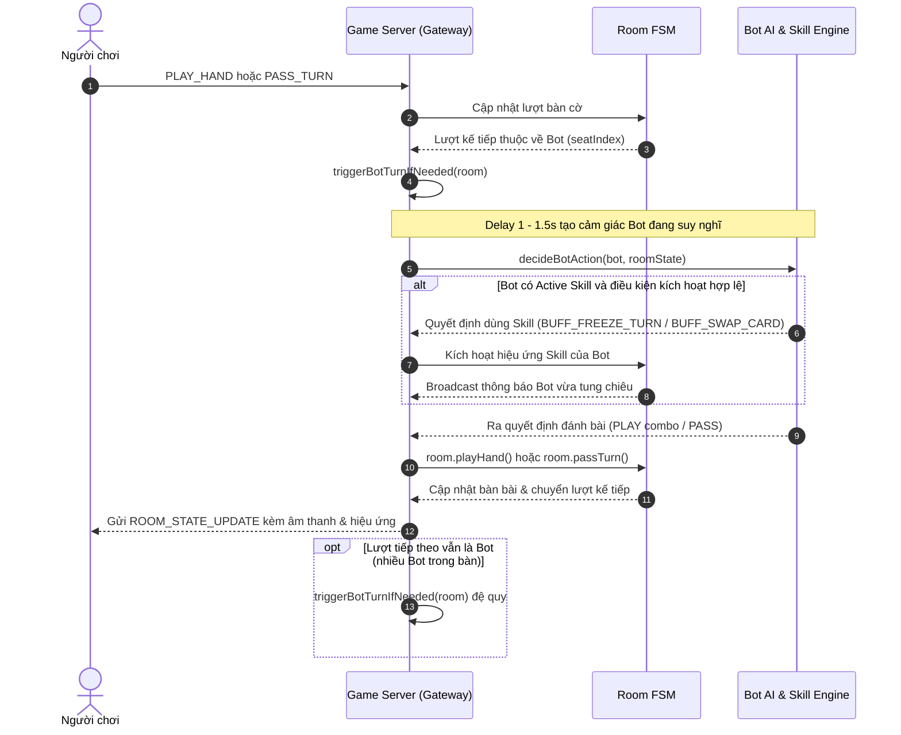

# Feature Specification: Sửa lỗi Bot tự đánh bài và Kích hoạt Kỹ năng (Bot System Fix & Skill Engine)

## 1. Context & Objectives
- **Bối cảnh:** Hiện tại trong game Tiến Lên Miền Nam Buff, khi người chơi thêm Bot vào bàn đấu (`🤖 + Thêm Bot`), Bot gặp lỗi nghiêm trọng:
  1. Khi tới lượt Bot (sau khi chia bài hoặc sau khi người chơi đánh/bỏ lượt), Bot đứng im không tự đánh bài vì thiếu event loop kích hoạt tự động (`triggerBotTurnIfNeeded`).
  2. Bot hoàn toàn không có logic sử dụng các kỹ năng Chủ Động (**Active Skills**) như `BUFF_FREEZE_TURN` (Băng Phong), `BUFF_SWAP_CARD` (Hoán Bài), `BUFF_SPY_HAND` (Mắt Thần).
  3. Kỹ năng Bị Động (**Passive Skills**) đôi khi không được gắn đúng khi draft hoặc thiếu log hiển thị cho người chơi biết Bot đang có buff gì.
- **Mục tiêu:**
  - Đảm bảo 100% vòng lặp trận đấu (Game Loop) chạy mượt mà: Bot tự động phân tích và ra bài sau 1 - 1.5 giây độ trễ (human-like delay).
  - Tích hợp **Bot Skill Engine**: Bot có trí tuệ quyết định thời điểm tung chiêu (ví dụ: dùng Băng Phong chặn người sắp hết bài, dùng Hoán Bài đổi lá rác nhỏ nhất 3♠, 4♠ thành lá mới).
  - Cập nhật UI thông báo rõ ràng cho người chơi khi Bot tung skill.

---

## 2. User Stories & Flow

### 2.1 User Story
- **Là một người chơi đơn**, tôi muốn khi bấm "Thêm Bot" và bắt đầu trận đấu, các Bot trong phòng phải tự động chọn Buff, tự động ra bài hoặc bỏ lượt khi đến vòng, và biết dùng chiêu để tạo tính cạnh tranh hấp dẫn như người chơi thật.

### 2.2 Sequence Diagram: Luồng kích hoạt lượt đi và dùng Skill của Bot

---

## 3. Core Mechanics & Rules

### 3.1 Vòng lặp kích hoạt Bot (Trigger Points)
Bot phải được tự động kích hoạt tại **TẤT CẢ** các thời điểm sau:
1. **Sau khi kết thúc BUFF_DRAFT:** Nếu người cầm cái đầu ván (được quyền đi trước) là Bot.
2. **Sau khi người chơi đánh bài (`PLAY_HAND`):** Nếu lượt kế tiếp là Bot.
3. **Sau khi người chơi bỏ lượt (`PASS_TURN`):** Nếu lượt kế tiếp là Bot.
4. **Sau khi người chơi dùng skill (`USE_BUFF`):** Nếu lượt vẫn là Bot hoặc chuyển sang Bot.
5. **Sau khi một Bot khác vừa đi xong:** Nếu lượt kế tiếp vẫn là một Bot khác (bàn 3-4 Bot).
6. **Sau khi hết vòng (tất cả người khác đã bỏ lượt):** Người thắng vòng là Bot được quyền đánh tự do lá mới.

### 3.2 Bot Skill AI (Trí tuệ dùng Buff của Bot)
Bot sẽ kiểm tra danh sách Buff mình đang sở hữu và quyết định dùng trước khi ra bài:

| Kỹ năng | Loại | Điều kiện Bot tự kích hoạt | Hành động của Bot |
| :--- | :--- | :--- | :--- |
| **BUFF_FREEZE_TURN** (Băng Phong) | Chủ động | Đối thủ kế tiếp chỉ còn $\le 3$ lá bài, HOẶC bàn đang có bài to mà Bot không đỡ được. | Đóng băng lượt của người kế tiếp, tước quyền đánh của họ trong vòng này. |
| **BUFF_SWAP_CARD** (Hoán Bài) | Chủ động | Trong tay Bot có lá rác nhỏ $\le 5$ (3♠, 3♣, 4♠...), và ván bài còn trên 8 lá. | Chọn lá rác nhỏ nhất trên tay để đổi lấy lá bài mới từ cọc dự trữ. |
| **BUFF_SPY_HAND** (Mắt Thần) | Chủ động | Đầu ván bài (ngay lượt đầu tiên của Bot). | Soi bài đối thủ kế tiếp để ghi nhận thông tin. |
| **BUFF_FIRST_STRIKE** (Tiên Thủ) | Tự động | Đầu ván. | Tự động giành quyền đi trước (đã có trong FSM). |
| **BUFF_PIG_ARMOR** (Giáp Heo) | Tự động | Khi đánh Heo bị chặt. | Tự động hấp thụ 1 lần chặt hoặc giảm tiền phạt (đã có trong BuffManager). |
| **BUFF_REFLECT_CUT** (Gương Phản Xạ) | Tự động | Khi Heo bị chặt. | Tự động phản đòn (đã có trong BuffManager). |
| **BUFF_REVIVE_PASS** (Tái Sinh Lượt) | Tự động | Khi bấm bỏ lượt. | Không bị mất quyền vào lại vòng (đã có trong BuffManager). |

### 3.3 Thuật toán Ra Bài của Bot
1. **Khi cầm vòng tự do:**
   - Đánh sảnh nhỏ nhất (nếu có).
   - Nếu không có sảnh, đánh ba nhỏ nhất.
   - Nếu không có ba, đánh đôi nhỏ nhất (không phải đôi heo).
   - Nếu toàn bài rác, đánh lá rác nhỏ nhất (loại trừ heo).
2. **Khi cần đè bài:**
   - Tìm bộ bài nhỏ nhất hợp lệ có thể đè (đơn, đôi, sám, sảnh).
   - Nếu đối thủ đánh heo và Bot có hàng (3 đôi thông, tứ quý, 4 đôi thông), Bot sẽ cân nhắc chặt heo nếu điểm phạt có lợi.
   - Nếu không có bài đè hoặc giữ bài chiến thuật $\rightarrow$ Bỏ lượt (`PASS`).

---

## 4. UI/UX Requirements
- **Bot Action Indicator:** Khi Bot đang suy nghĩ, hiển thị trạng thái "Bot đang suy nghĩ... 🤔" trên avatar của Bot.
- **Skill Activation Toast & Banner:** Khi Bot tung kỹ năng (ví dụ `Bot Nam đã dùng Băng Phong đóng băng lượt của bạn!`), hiển thị Toast màu tím/vàng nổi bật và phát âm thanh tương ứng.
- **Card Animation:** Lá bài Bot đánh ra được bay từ avatar Bot vào giữa bàn (trung tâm bàn chơi).

---

## 5. Edge Cases & Error Handling
1. **Bàn chơi gồm 3 Bot và 1 Người:** Các Bot phải đánh luân phiên nhau mà không làm nghẽn Event Loop (`setTimeout` đệ quy an toàn, không gây Stack Overflow hay Race Condition).
2. **Bot bị đóng băng:** Khi tới lượt Bot nhưng Bot đang dính trạng thái `FROZEN`, Bot tự động bị skip lượt và chuyển sang người kế tiếp mà không bị treo timer.
3. **Người chơi thoát phòng hoặc mất kết nối giữa trận:** Bot vẫn tiếp tục đánh bình thường theo đúng lượt.
4. **Hết bài cọc rút (Draw Pile trống):** Khi Bot dùng `BUFF_SWAP_CARD` nhưng không còn bài để đổi $\rightarrow$ Huỷ lệnh mượt mà, Bot chuyển sang đánh bài bình thường.

---

## 6. Acceptance Criteria
- [x] Bot tự động đánh bài trong vòng 1 - 1.5s khi tới lượt sau khi chia bài / sau khi người chơi đánh.
- [x] Bàn chơi có từ 1 đến 3 Bot hoạt động trơn tru không bị treo hoặc đứng hình ở bất kỳ lượt nào.
- [x] Bot biết tự kích hoạt `BUFF_FREEZE_TURN` khi đối thủ cạnh tranh sắp hết bài.
- [x] Bot biết tự kích hoạt `BUFF_SWAP_CARD` để đổi bài rác.
- [x] Có thông báo Toast hiển thị khi Bot sử dụng kỹ năng.
- [x] Ván bài kết thúc bình thường và hiển thị bảng điểm đầy đủ khi Bot thắng hoặc Người chơi thắng.

