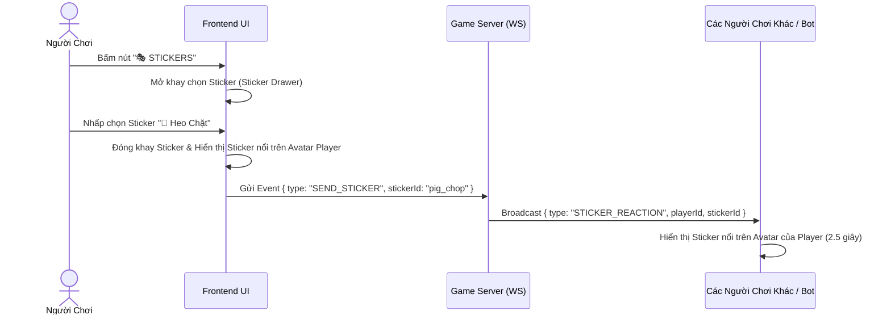

# Feature Specification: Tiết Chế Hiệu Ứng Chuyển Động (Calm Animations) & Bổ Sung Hệ Thống Sticker Cảm Xúc (Interactive Stickers)

## 1. Context & Objectives

### 1.1 Bối Cảnh
Sau khi nâng cấp đồ họa Balatro Retro CRT Punk, giao diện trở nên rất sống động. Tuy nhiên, người chơi phản hồi:
1. **Chuyển động quá dồn dập (Over-animated):**
   - Các lá bài trên tay liên tục nhấp nhô (`balatro-card-bob` -7px lặp lại vô tận) khiến mắt người chơi bị mỏi và khó tập trung tính toán đường bài.
   - Nền plasma chuyển động sóng (`time += 0.022`) và góc nghiêng 3D của thẻ bài (`14deg`) khi rê chuột hơi nhanh và gắt.
   - Các nhãn điểm và chip rung lắc liên tục (`balatro-jiggle`).
2. **Nhu cầu giao tiếp tương tác bằng Sticker cảm xúc:**
   - Người chơi mong muốn có thêm bộ Sticker cảm xúc phong cách đồ họa như trên [Flaticon Stickers](https://www.flaticon.com/stickers) để thả biểu cảm, gáy vui, phản ứng khi bị chặt bài, chặt heo hay thắng ván tương tự các game bài chuyên nghiệp (Governor of Poker, ZingPlay, Discord Activities).

### 1.2 Mục Tiêu
- **Giảm tải chuyển động (Calm & Focused UX):**
  - Tắt hiệu ứng nhấp nhô liên tục của các lá bài trên tay khi đứng yên, chỉ kích hoạt nâng nhẹ mượt mà khi rê chuột (`hover`).
  - Giảm góc nghiêng 3D khi di chuột từ `14deg` xuống góc vi tế `4deg - 5deg`, scale dịu nhẹ từ `1.12` xuống `1.05`.
  - Giảm tốc độ trôi của nền plasma xuống 3-4 lần (`0.006`), biến nền thành dải ngân hà huyền ảo chuyển màu êm dịu, không gây chóng mặt.
  - Tắt hiệu ứng rung lắc liên tục (`jiggle`) ở nhãn chip, chỉ giữ hiệu ứng pop nhảy số khi có biến động tiền thưởng.
- **Hệ thống Sticker Biểu Cảm Thời Gian Thực (Interactive Real-Time Stickers):**
  - Tích hợp khay chọn Sticker (Sticker Picker) hiện đại với bộ Sticker đồ họa vector (SVG) phong cách Flaticon sắc nét: Heo vàng chặt chém, Thug life gáy to, Khóc ròng vì thúi heo, Tức giận bốc hỏa, Thả tim, Bom nổ, Hốt bạc...
  - Hỗ trợ gửi Sticker qua WebSocket đến tất cả người chơi trong phòng.
  - Sticker bay lên trên avatar người gửi với hiệu ứng nảy nhẹ (Gentle Pop & Float Up) rồi tự biến mất sau 2.5 giây.
  - Tích hợp cho Bot AI: Bot tự động thả sticker biểu cảm khi chặt heo (🐷), khi bị chặt (😭), hoặc khi thắng ván (😎).

---

## 2. User Stories & Acceptance Criteria

### 2.1 User Stories
- **Là người chơi đánh bài**, tôi muốn các lá bài trên tay đứng yên vững chãi, rõ ràng để tôi dễ nhìn, dễ chọn bài mà không bị hoa mắt bởi chuyển động nhấp nhô liên tục.
- **Là người chơi trong phòng**, tôi muốn bấm vào nút Sticker để chọn biểu cảm (Heo, Khóc, Cười, Bom...) và biểu cảm đó sẽ bay bổng trên avatar của tôi cho bạn bè cùng thấy.
- **Là người chơi thi đấu với Bot**, tôi muốn thấy Bot có cảm xúc tự động phản ứng (ví dụ khóc khi bị chặt bài) giúp trận đấu thêm phần vui nhộn.

### 2.2 Acceptance Criteria
- [x] Gỡ bỏ hiệu ứng nhấp nhô liên tục (`balatro-card-bob`) của thẻ bài khi ở trạng thái nghỉ; thẻ bài chỉ nâng lên 12px êm ái khi rê chuột vào hoặc khi được chọn (`selected`).
- [x] Giảm độ nghiêng chuột 3D tilt xuống mức dịu nhẹ ($\le 5^\circ$).
- [x] Giảm tốc độ shader plasma nền xuống mức êm ái ($\approx 0.006$) tạo cảm giác thư thái.
- [x] Thêm nút mở khay Sticker `🎭 STICKERS` tại thanh điều khiển.
- [x] Khay Sticker mở ra danh sách 9 Sticker vector phong cách Flaticon (Heo Chặt, Khóc, Cười Ngầu, Tức Giận, Bom Nổ, Thả Tim, Tiền Vàng, Vỗ Tay, Đóng Băng).
- [x] Khi bấm Sticker, biểu tượng hiển thị dạng bong bóng bay nổi phía trên avatar của người chơi và đồng bộ tới toàn bộ người chơi trong phòng qua WebSocket (`STICKER_EVENT`).
- [x] Bot AI tự động thả sticker phù hợp theo ngữ cảnh (chặt heo, bị phạt, chiến thắng).
- [x] Không làm giật lag, giữ nguyên vẹn logic game bài và 48 bài kiểm thử tự động.

---

## 3. Interaction & Animation Flow

