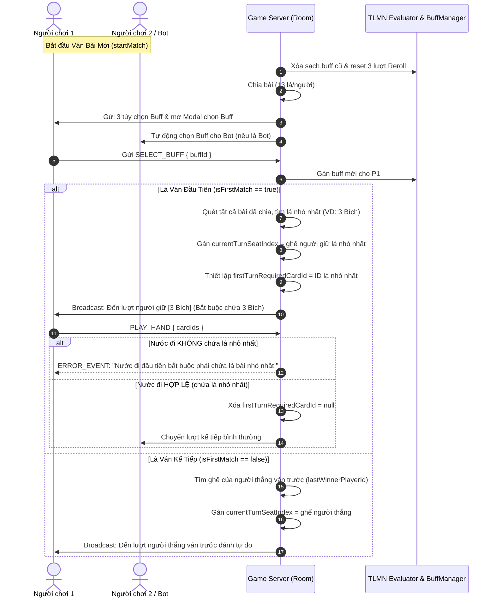

# Feature Specification: Luật Đi Đầu (Ván Đầu / Ván Kế Tiếp) & Sửa Triệt Để Tính Năng Chọn Buff Mới (First Turn Rules & Buff Draft Fix)

## 1. Context & Objectives (Bối Cảnh & Mục Tiêu)

### 1.1 Bối Cảnh
Hiện tại trong hệ thống Tiến Lên Miền Nam Buff Roguelike:
1. **Lượt đi đầu tiên chưa đúng luật truyền thống:**
   - Khi bắt đầu ván đấu, hệ thống luôn mặc định gán lượt cho ghế 0 (`currentTurnSeatIndex = 0`) bất kể ai là người thắng ván trước hay ai đang giữ lá bài nhỏ nhất.
   - Chưa có cơ chế nhận diện người thắng ván trước để trao quyền đi trước ở ván kế tiếp.
   - Ở ván đấu đầu tiên (First Game), chưa tìm người cầm lá bài nhỏ nhất được chia (3 Bích `3♠` hoặc lá nhỏ nhất trong các lá đã chia khi phòng 2-3 người), và chưa bắt buộc nước đi đầu tiên phải chứa lá bài nhỏ nhất đó.
2. **Lỗi chọn Buff mới trước khi bắt đầu ván (Buff Draft Bug):**
   - Ở các ván sau (khi bấm "VÁN TIẾP THEO ▶"), hàm `initializePlayer` trong `BuffManager` không xóa các ô buff cũ (`playerSlots`), khiến server nhận định người chơi đã có buff nên lập tức nhảy cóc qua giai đoạn `BUFF_DRAFT` vào thẳng `PLAYING`.
   - Người chơi không được cấp 3 lượt roll mới và không hiện cửa sổ Booster Pack để chọn thẻ buff mới toanh trước mỗi ván.

### 1.2 Mục Tiêu
- **Luật đi đầu ván kế tiếp:** Người chơi về Nhất (chiến thắng) ở ván trước sẽ là người được quyền đánh đầu tiên ở ván tiếp theo.
- **Luật đi đầu ván đầu tiên:** Người chơi cầm lá bài có giá trị nhỏ nhất khi được chia (thấp nhất theo Thứ tự: 3 < 4 ... < A < 2 và Chất: ♠ < ♣ < ♦ < ♥) sẽ được quyền đánh trước. Nước đi đầu tiên cho phép đánh bất kỳ Hand Type hợp lệ nào (Rác, Đôi, Sám, Sảnh, 3 Đôi Thông, Tứ Quý...) nhưng **bắt buộc phải chứa lá bài nhỏ nhất đó**.
- **Sửa triệt để chọn Buff mới trước mỗi ván:** Xóa sạch buff cũ khi bắt đầu ván mới, reset 3 lượt Reroll, mở cửa sổ chọn Buff cho người chơi, tự động gán buff cho Bot và chỉ chuyển sang `PLAYING` sau khi tất cả người chơi đã hoàn tất việc chọn buff.

---

## 2. User Stories & Flow

### 2.1 User Stories
- **Là người chơi thắng ván trước**, tôi muốn ở ván kế tiếp được quyền đi trước để phát huy lợi thế quán quân.
- **Là người chơi cầm lá bài nhỏ nhất (ví dụ 3 Bích) ở ván đầu**, tôi muốn được quyền đi trước và có thể tùy biến đánh lá rác 3 Bích, hoặc kẹp vào đôi 3, sảnh 3-4-5... miễn là có chứa lá bài nhỏ nhất đó.
- **Là người chơi vô tình chọn nước đi đầu tiên không chứa lá nhỏ nhất**, tôi muốn giao diện và máy chủ cảnh báo ngay bằng tiếng Việt, từ chối nước đi sai luật và hướng dẫn tôi chọn lại.
- **Là người chơi bước sang ván mới**, tôi muốn được chọn lại 1 thẻ buff mới từ 3 lựa chọn ngẫu nhiên kèm 3 lượt Đổi lại (Reroll), không bị bỏ qua hay lưu lại buff cũ.

### 2.2 Sequence Diagram: Luồng Ván Đầu Tiên vs Ván Kế Tiếp

---

## 3. Core Mechanics & Rules (Quy Tắc Nghiệp Vụ)

### 3.1 Quy Tắc Lượt Đi Đầu Ván 1 (First Game Opening Rule)
1. **Xác định lá bài nhỏ nhất toàn bàn:**
   - So sánh toàn bộ các lá bài được chia cho người chơi trong phòng theo thứ tự chuẩn TLMN:
     $$\text{Rank}(3 < 4 < \dots < A < 2) \quad \text{và} \quad \text{Suit}(♠ < ♣ < ♦ < ♥)$$
   - Nếu đủ 4 người: luôn là **3 Bích (3♠)**.
   - Nếu phòng 2 hoặc 3 người (bài chia ngẫu nhiên từ cọc 52 lá): là lá bài có giá trị nhỏ nhất trong số tất cả các lá bài nằm trên tay người chơi.
2. **Xác định người đi đầu:**
   - Ghế của người chơi sở hữu lá bài nhỏ nhất sẽ là `currentTurnSeatIndex` và `roundLeaderSeatIndex`.
   - `firstTurnRequiredCardId` được lưu tạm thời trên GameRoom.
3. **Quy tắc nước đi đầu tiên:**
   - Người đi đầu được quyền đánh bất kỳ bộ bài hợp lệ (Hand Type) nào:
     - Đánh rác (Single): chứa lá nhỏ nhất.
     - Đánh đôi (Pair): chứa lá nhỏ nhất (VD: Đôi 3 có 3♠).
     - Đánh sám cô (Triple): chứa lá nhỏ nhất.
     - Đánh sảnh (Straight): chứa lá nhỏ nhất (VD: Sảnh 3♠-4-5-6).
     - Đánh 3 đôi thông / Tứ quý: chứa lá nhỏ nhất.
   - **Bắt buộc:** Bộ bài đánh ra phải chứa lá bài nhỏ nhất đó (`cardsToPlay.some(c => c.id === firstTurnRequiredCardId)`).
   - Nếu vi phạm: Server trả lỗi, Client chặn trước ngay từ nút ĐÁNH BÀI và hiển thị Toast nhắc nhở.
   - Sau khi nước đi đầu tiên được chấp thuận: `firstTurnRequiredCardId = null`, ván đấu tiếp tục với luật đè bài bình thường.

### 3.2 Quy Tắc Lượt Đi Đầu Các Ván Kế Tiếp (Subsequent Games Opening Rule)
1. Khi ván đấu kết thúc (`MATCH_END`):
   - Lưu trữ `lastWinnerPlayerId = winner.id`.
   - Đánh dấu `isFirstMatch = false`.
2. Khi bắt đầu ván mới (`startMatch` sau khi bấm "VÁN TIẾP THEO ▶"):
   - Kiểm tra `lastWinnerPlayerId` có còn trong phòng và đang kết nối hay không.
   - Nếu còn: Gán `currentTurnSeatIndex` và `roundLeaderSeatIndex` cho người chơi đó. Người này được quyền đánh tự do bất kỳ tổ hợp nào mà không bị ràng buộc lá nhỏ nhất.
   - Nếu người thắng cũ đã rời phòng: Quay về cơ chế tìm người cầm lá bài nhỏ nhất của ván đó.

### 3.3 Quy Tắc Làm Mới Buff Mỗi Ván (Fresh Buff Draft Every Match)
1. Tại thời điểm `startMatch()` hoặc `resetToLobby()`:
   - Gọi `buffManager.resetPlayerBuffs(pid)` (xóa sạch các ô buff cũ của ván trước).
   - Reset số lượt Reroll của mỗi người chơi về `3`.
   - Sinh ngẫu nhiên 3 thẻ buff mới và lưu vào `draftOptions.set(pid, options)`.
   - Trạng thái phòng chuyển sang `RoomStatus.BUFF_DRAFT`.
2. Tự động chọn buff cho Bot:
   - Bot tự động gán buff đầu tiên và xóa options của Bot.
3. Khi người chơi nhấn chọn thẻ Buff:
   - Client gửi `SELECT_BUFF { buffId }`.
   - Server gán buff cho người chơi và **xóa ngay** `draftOptions.delete(pid)`.
   - Khi tất cả người chơi hoàn tất chọn buff: Phòng chuyển sang `RoomStatus.PLAYING` và bắt đầu tính lượt đi đầu theo Quy tắc 3.1 hoặc 3.2.

---

## 4. UI/UX Requirements (Yêu Cầu Giao Diện)

### 4.1 Huy Hiệu & Đèn Báo Nước Đi Đầu
- **Hiển thị thông tin lá bắt buộc:**
  - Nếu là lượt đầu của ván đầu: Huy hiệu gợi ý (`comboPreviewBadge`) hiển thị màu vàng neon: `💡 VÁN ĐẦU: Bắt buộc đánh bộ bài chứa [3♠]` (hoặc ký hiệu lá nhỏ nhất tương ứng).
  - Lá bài nhỏ nhất trên tay người chơi được gắn viền sáng nhấp nháy đặc biệt màu tím neon hoặc xanh ngọc để người chơi nhận diện ngay.
- **Nút ĐÁNH BÀI:**
  - Nếu người chơi chọn bài nhưng quên chọn lá nhỏ nhất: Nút Đánh Bài ở trạng thái `btn-play-inactive`. Khi nhấn vào sẽ bật Toast: `⚠️ Nước đi đầu tiên của ván đầu bắt buộc phải chứa lá [3♠]!`.

### 4.2 Giao Diện Cửa Sổ Chọn Buff
- Đảm bảo hiển thị mượt mà mỗi khi sang ván mới.
- Hiển thị đầy đủ số lượt đổi lại: `🎲 ĐỔI LẠI (Còn 3/3)`.
- Nhấn chọn buff -> Modal biến mất êm ái, khay buff dưới đáy màn hình cập nhật ngay thẻ bài mới.

---

## 5. Edge Cases & Error Handling (Tình Huống Ngoại Lệ)

| Tình huống ngoại lệ | Xử lý của hệ thống |
| :--- | :--- |
| **Phòng 2 hoặc 3 người không có 3 Bích (3♠)** | Thuật toán quét toàn bộ bài của các người chơi thực tế có mặt trong ván, tìm lá bài có `rank` nhỏ nhất và `suit` nhỏ nhất làm lá bắt buộc. |
| **Người thắng ván trước thoát phòng trong lúc chờ** | Nhận diện `lastWinnerPlayerId` không còn tồn tại -> Tự động chuyển sang cơ chế tìm người giữ lá nhỏ nhất trong số người chơi còn lại. |
| **Bot là người đi đầu ở ván đầu tiên** | Bot AI (`decideBotMove`) nhận biết cờ `firstTurnRequiredCardId` để ưu tiên tạo bộ sảnh/đôi/rác có chứa lá nhỏ nhất đó, không bị từ chối nước đi. |
| **Hết 15 giây đếm ngược ở lượt đi đầu ván 1** | Hàm `handleTurnTimeout` tự động đánh tổ hợp nhỏ nhất chứa lá bài bắt buộc (hoặc đánh chính lá bài bắt buộc đó nếu đánh rác). |
| **Người chơi nhấn Reroll Buff khi đã hết 3 lượt** | Server từ chối và Client vô hiệu hóa nút đổi lại, hiển thị `(Còn 0/3)`. |

---

## 6. Acceptance Criteria (Tiêu Chí Nghiệm Thu)

- [x] **AC 1:** Ở ván đấu đầu tiên, người chơi sở hữu lá bài nhỏ nhất trong toàn bộ bài đã chia sẽ luôn là người được đánh trước.
- [x] **AC 2:** Ở ván đấu đầu tiên, nước đi đầu tiên bắt buộc phải chứa lá bài nhỏ nhất đó. Nếu đánh bộ bài không có lá này, Server trả về lỗi `INVALID_FIRST_TURN_CARD` và Client hiện toast cảnh báo.
- [x] **AC 3:** Nước đi đầu tiên có thể là bất kỳ bộ hợp lệ nào (Rác, Đôi, Sám, Sảnh, Đôi thông, Tứ quý) miễn là có chứa lá nhỏ nhất.
- [x] **AC 4:** Sau khi nước đi đầu tiên được thực hiện thành công, các lượt tiếp theo đánh bình thường không còn ràng buộc lá nhỏ nhất.
- [x] **AC 5:** Khi một ván bài kết thúc và người chơi nhấn "VÁN TIẾP THEO ▶", người chiến thắng ván trước sẽ là người được đánh đầu tiên ở ván sau.
- [x] **AC 6:** Mỗi ván bài mới, toàn bộ buff cũ bị xóa bỏ, người chơi được hồi lại đủ 3 lượt Reroll và cửa sổ Booster Pack hiện lên cho phép chọn thẻ buff mới.
- [x] **AC 7:** Bot AI nhận biết đúng luật đi đầu ván 1 để ra bài hợp lệ, không bị lỗi timeout hoặc deadlock.
- [x] **AC 8:** Toàn bộ Unit Test hiện có (56/56) đều PASS 100% và TypeScript build 0 lỗi.

