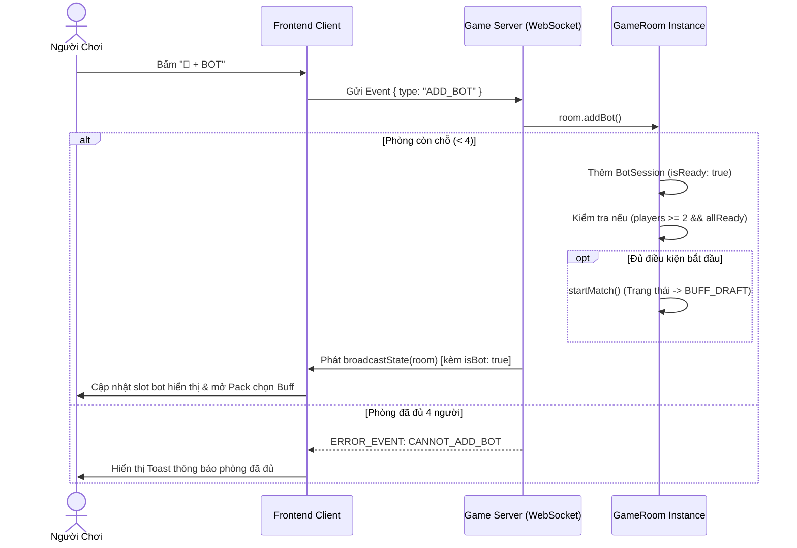

# Feature Specification: Quét & Sửa Lỗi Tính Năng Game - Khắc Phục Lỗi Add Bot & Quản Lý Vòng Đời Phòng Chơi

## 1. Context & Objectives

### 1.1 Bối Cảnh
Người dùng phát hiện lỗi nghiêm trọng: **Không thể Add Bot vào phòng chơi** khi đang trải nghiệm game trên giao diện web / Discord Activity.

### 1.2 Nguyên Nhân Gốc Rễ Đã Điều Tra (Root Cause Analysis)
1. **Lỗi Kẹt Phòng & Người Chơi Ma (Ghost Players / Stale Room Lock):**
   - Khi người chơi tải lại trang (F5) hoặc kết nối lại, server tạo một `playerId` ngẫu nhiên mới.
   - Khi WebSocket đóng (`ws.on('close')`), server chỉ xóa `clients.delete(ws)` mà **không dọn dẹp người chơi hoặc bot trong phòng** (`room.players`).
   - Phòng mặc định (`default_room`) bị lấp đầy 4 người chơi "ma" hoặc kẹt ở trạng thái thi đấu cũ. Lần kết nối tiếp theo, server trả về `ROOM_FULL` ("Phòng đã đầy hoặc đang thi đấu"), khiến `client.roomId` không được gán, dẫn đến việc bấm nút `🤖 + BOT` hoàn toàn bị server bỏ qua.
2. **Lỗi Không Tự Động Bắt Đầu Trận Khi Add Bot:**
   - Trong `room.addBot()`, bot được thêm với `isReady: true`. Tuy nhiên, logic kiểm tra `if (players.length >= 2 && every(isReady)) startMatch()` chỉ nằm ở hàm `setReady()`, chứ không có trong `addBot()`.
   - Nếu người chơi đã bấm "Sẵn sàng" trước rồi mới bấm `+ BOT`, trận đấu sẽ không bao giờ tự động khởi động.
3. **Thiếu Thuộc Tính `isBot` Trong Dữ Liệu Phát Sóng (`broadcastState`):**
   - `broadcastState` lược bỏ trường `isBot: p.isBot`. Client không phân biệt được đâu là Bot để hiển thị trạng thái suy nghĩ (`THINKING...`) hoặc icon tương ứng.
4. **Trạng Thái Phòng Chờ Chưa Trực Quan:**
   - Trong lúc ở Lobby, đối thủ hiển thị `[0 CARDS]` thay vì nhãn trạng thái `READY` hoặc `CHỜ...`, khiến người chơi lúng túng không biết bot/bạn bè đã sẵn sàng chưa.

### 1.3 Mục Tiêu
- Sửa triệt để lỗi Add Bot, đảm bảo người chơi có thể thêm bot và bắt đầu chơi ngay lập tức dù chơi 1 mình với 1, 2, hay 3 bot.
- Dọn dẹp phòng chơi tự động khi người chơi ngắt kết nối hoặc rời phòng.
- Hỗ trợ lưu trữ `playerId` trong `sessionStorage` / `localStorage` để khi F5 không bị tạo session mới gây kẹt phòng.
- Bắt đầu trận mượt mà ngay khi đủ điều kiện (2 - 4 người và tất cả đã sẵn sàng).
- Cập nhật UI Lobby hiển thị rõ trạng thái `READY` của từng người chơi/bot.

---

## 2. User Stories & Acceptance Criteria

### 2.1 User Stories
- **Là người chơi solo**, tôi muốn bấm nút `🤖 + BOT` trong phòng chờ để thêm 1, 2 hoặc 3 Bot vào phòng một cách tức thì.
- **Là người chơi đã sẵn sàng**, khi tôi bấm thêm Bot (Bot mặc định sẵn sàng), game phải tự động bắt đầu ván bài và chuyển sang màn hình chọn Buff Booster Pack ngay mà không cần tôi phải hủy sẵn sàng rồi bấm lại.
- **Là người chơi khi F5/refresh trang**, tôi muốn được tự động kết nối lại vào slot cũ của mình mà không bị thông báo "Phòng đã đầy".

### 2.2 Acceptance Criteria
- [x] Bấm `🤖 + BOT` thêm thành công Bot vào ghế trống (`slot-top`, `slot-left`, `slot-right`).
- [x] Nếu người chơi đã Ready và thêm Bot -> Game tự động chia bài và chuyển sang trạng thái `BUFF_DRAFT` ngay lập tức.
- [x] Khi người chơi ngắt kết nối trong Lobby -> Xóa người chơi khỏi phòng. Nếu trong phòng chỉ còn toàn Bot -> Tự động dọn dẹp sạch phòng để người chơi mới vào không bị lỗi `ROOM_FULL`.
- [x] Gửi đầy đủ `isBot: true/false` trong gói tin `ROOM_STATE_UPDATE` để client nhận diện đúng Bot.
- [x] Hiển thị nhãn `SẴN SÀNG` (READY - màu xanh) hoặc `CHƯA SẴN SÀNG` trên thẻ người chơi khi đang ở Lobby.
- [x] Vô hiệu hóa nút `+ BOT` khi phòng đã đủ 4 người chơi để tránh gửi yêu cầu thừa.
- [x] Toàn bộ 48 unit tests và các test suite mới cho Session/Disconnect đều pass 100%.

---

## 3. Workflow Diagrams

