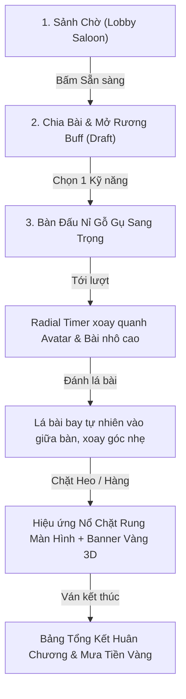

# Feature Specification: Nâng cấp Đồ họa phong cách Governor of Poker 3 (GOP3 Visual Upgrade)

## 1. Context & Objectives
- **Bối cảnh:** Hiện tại, giao diện TLMN Activity có cấu trúc cơ bản với bàn nỉ xanh phẳng, thẻ bài tối giản và các nút hành động dạng phẳng (flat UI). Dù các tính năng kỹ thuật và logic đã hoạt động trơn tru, trải nghiệm thị giác của người chơi vẫn chưa đủ độ sâu, sự cuốn hút và hào hứng như các tựa game bài cao cấp.
- **Cảm hứng thiết kế:** **Governor of Poker 3 (GOP3)** — tựa game poker đình đám thế giới với phong cách:
  - Bàn đấu gỗ gụ (Mahogany) bóng bẩy với viền nẹp kim loại vàng đồng (Antique Gold) và đinh tán kiểu Viễn Tây (Wild West).
  - Khung Avatar người chơi hình oval/tròn 3D với vòng đếm ngược thời gian (Radial Countdown Timer) xoay tròn sống động.
  - Thẻ bài bóng bẩy (Glossy), có vân giấy nổi (Linen texture), đổ bóng chân thực đa lớp, góc nghiêng tự nhiên khi bay vào giữa bàn.
  - Các nút hành động 3D nổi khối (Tactile 3D Buttons) có độ nảy khi bấm.
  - Khay Buff mang phong cách huy hiệu cảnh trưởng (Sheriff Medallions / Pocket Watch Relics) phát sáng theo độ hiếm.
  - Hiệu ứng Chặt bài / Thắng ván hoành tráng kiểu Western Saloon với pháo hoa vàng và đồng xu rơi.
- **Mục tiêu:**
  - Nâng cấp toàn diện CSS/HTML và hoạt họa giao diện người dùng đạt đẳng cấp casino cao cấp.
  - Đảm bảo hiệu năng mượt mà 60 FPS trên cả Discord Activity Desktop lẫn Mobile, không dùng asset hình ảnh nặng gây chậm tải.

---

## 2. User Stories & Flow

### 2.1 User Story
- **Là một người chơi**, tôi muốn khi bước vào bàn chơi TLMN Buff, tôi cảm nhận được sự sang trọng, kịch tính và sống động như đang ngồi trong một sòng bạc Saloon viễn tây chuẩn GOP3, từng lá bài đánh ra có độ đầm, từng nút bấm có độ nảy và avatar hiển thị thời gian đếm ngược rõ ràng.

### 2.2 Visual Progression Flow

---

## 3. Core Mechanics & Visual Design System

### 3.1 Bảng màu chuẩn Casino GOP3 (Design Tokens)
| Thành phần | Mã màu / Gradient | Hiệu ứng thị giác |
| :--- | :--- | :--- |
| **Viền bàn Saloon Rim** | `linear-gradient(#3e1c0d, #1f0b04)` kèm nẹp `#d4af37` | Gỗ gụ đánh bóng viền nẹp vàng đồng, có đinh tán góc |
| **Mặt nỉ bàn chơi (Felt)** | `radial-gradient(#1e5838 0%, #0d2e1c 100%)` | Nỉ casino xanh lục bảo sâu, viền dập chìm họa tiết chìm |
| **Thẻ bài (Cards)** | Mặt trước: Trắng sứ bóng `#fdfdfd`, đổ bóng `box-shadow: 0 10px 20px rgba(0,0,0,0.4)` | Chữ số to rõ, hoa văn chất bài Ruby Red (Cơ, Rô) và Charcoal Black (Bích, Chuồn) |
| **Nút Đánh bài (Play)** | `linear-gradient(#ffcc00, #ff9900)` viền vàng nổi khối | Nút vàng rực rỡ, chữ nổi đậm, ánh kim cương khi tới lượt |
| **Nút Bỏ lượt (Pass)** | `linear-gradient(#e53935, #b71c1c)` | Đỏ đậm ruby, vân da thuộc |
| **Nút Tiện ích (Bot, Sắp bài)**| `linear-gradient(#37474f, #212121)` viền bạc | Kim loại xước nam tính |
| **Độ hiếm Buff (Rarity)** | Common: Đồng `#cd7f32`, Rare: Bạc `#00b0ff`, Epic: Vàng `#ffd700`, Legendary: Thạch anh tím `#e040fb` | Viền kim loại phát quang tỏa hào quang Neon (Outer Glow) |

### 3.2 Khung Avatar 3D & Radial Countdown Timer
- **Avatar Pods:**
  - Khung tròn gỗ bo nẹp vàng dập nổi với bóng đổ sâu.
  - Phía trên avatar có badge huy hiệu hiển thị tên người chơi và chip cược (`🪙 1,000`).
  - **Radial Timer Sweep:** Khi tới lượt người chơi, một vòng viền sáng LED (Gradient Xanh Lá $\rightarrow$ Vàng $\rightarrow$ Đỏ) quét tròn 360 độ quanh Avatar đếm ngược 15 giây.
  - Khi Bot suy nghĩ: hiển thị bong bóng chat động `"Đang nghĩ... 🤔"`.
  - Khi bỏ lượt: Avatar hơi mờ nhẹ (grayscale 40%) và gắn huy hiệu `"BỎ LƯỢT"` đỏ mờ.

### 3.3 Thiết kế Thẻ Bài & Hiệu Ứng Ném Bài (Card Toss Physics)
- **Thẻ bài trên tay:**
  - Thiết kế tỉ lệ chuẩn Poker (2.5 : 3.5), bo góc $8px$, có viền chỉ bạc mảnh.
  - Khi hover hoặc chọn bài: Thẻ bài nhấc bổng lên cao $18px$, phát ra ánh sáng viền xanh neon và hơi nghiêng nhẹ theo vị trí trên tay (fan effect).
- **Thẻ bài đánh giữa bàn (Pot):**
  - Không xếp cứng nhắc mà mỗi lá bài ném xuống được áp dụng một góc xoay ngẫu nhiên nhẹ (từ $-5^\circ$ đến $+5^\circ$) giống hệt cách người chơi ném bài thật trong Governor of Poker 3.
  - Xếp lớp so le (layered cascade) giúp nhìn rõ toàn bộ các lá bài trong bộ bài vừa đánh.

### 3.4 Khay Buff Roguelike kiểu Huy Hiệu Cảnh Trưởng (Sheriff Relics)
- Mỗi Buff được thiết kế như một **Huy hiệu ngôi sao / Đồng hồ quả quýt cổ**:
  - Khung kim loại dập nổi hoa văn viễn tây.
  - Icon biểu tượng ở giữa phát sáng pulsing.
  - Hiển thị số lượt dùng còn lại dưới dạng các viên ngọc năng lượng nhỏ dưới chân thẻ.
  - Khi bấm kích hoạt: Huy hiệu xoay tròn phát ra tia sáng vàng/tím tỏa ra bàn chơi.

### 3.5 Bảng Tổng Kết Ván Bài (Victory Saloon Modal)
- Banner chiến thắng kiểu Cờ Phướn Hoàng Gia hoặc Poster Wanted Viễn Tây dập vàng:
  - Danh hiệu vinh danh: **🏆 QUÁN QUÂN SALOON**, **Á QUÂN**, **CỐNG BÀI / THỐI HEO**.
  - Hiệu ứng pháo hoa giấy vàng (Confetti CSS particles) và tiếng chuông reo chiến thắng vang dội.

---

## 4. UI/UX Requirements & Responsiveness
- **Tối ưu hiển thị đa kích thước:**
  - Hoạt động hoàn hảo trong khung nhúng Activity Discord (kể cả khi cửa sổ co nhỏ $800 \times 600$ hoặc phóng to toàn màn hình $1920 \times 1080$).
  - Bàn chơi tự động scale theo tỉ lệ bàn Oval không bị méo tỉ lệ chữ số.
- **Tương thích Touch & Click:**
  - Nút bấm và lá bài có hit-box rộng rãi, dễ bấm trên cả chuột máy tính lẫn màn hình cảm ứng điện thoại.

---

## 5. Edge Cases & Error Handling
1. **Màn hình cực nhỏ (Mobile Discord Client):** Tự động thu nhỏ font chữ và co gọn khoảng cách giữa các lá bài (overlap card fan) để không tràn viền.
2. **Nhiều lá bài đánh ra cùng lúc (Sảnh 10 lá, Sảnh rồng):** Tự động thu nhỏ tỷ lệ bài giữa bàn để luôn nằm trọn trong trung tâm bàn nỉ.
3. **Mất kết nối:** Avatar chuyển sang trạng thái xám tro kèm biểu tượng mất sóng `📡❌`.

---

## 6. Acceptance Criteria
- [x] Mặt bàn chuyển sang chất liệu nỉ ngọc bích sâu với viền gỗ gụ nẹp vàng 3D sang trọng.
- [x] Avatar người chơi có khung viền 3D kim loại và vòng đếm ngược thời gian xoay tròn (Radial Countdown Timer).
- [x] Thẻ bài đạt độ bóng cao, hoa văn sắc nét, có hoạt họa nhấc bài và xoay góc ngẫu nhiên khi ném ra giữa bàn.
- [x] Toàn bộ các nút bấm chuyển sang giao diện 3D nổi khối kiểu Saloon Viễn Tây (Tactile Buttons).
- [x] Khay Buff hiển thị dạng huân chương / bảo vật cổ viễn tây với ánh sáng theo độ hiếm.
- [x] Banner Chặt heo và Bảng tổng kết được thiết kế lộng lẫy phong cách Governor of Poker 3.
- [x] Đạt 60 FPS mượt mà, không phụ thuộc file ảnh nặng từ bên ngoài.

