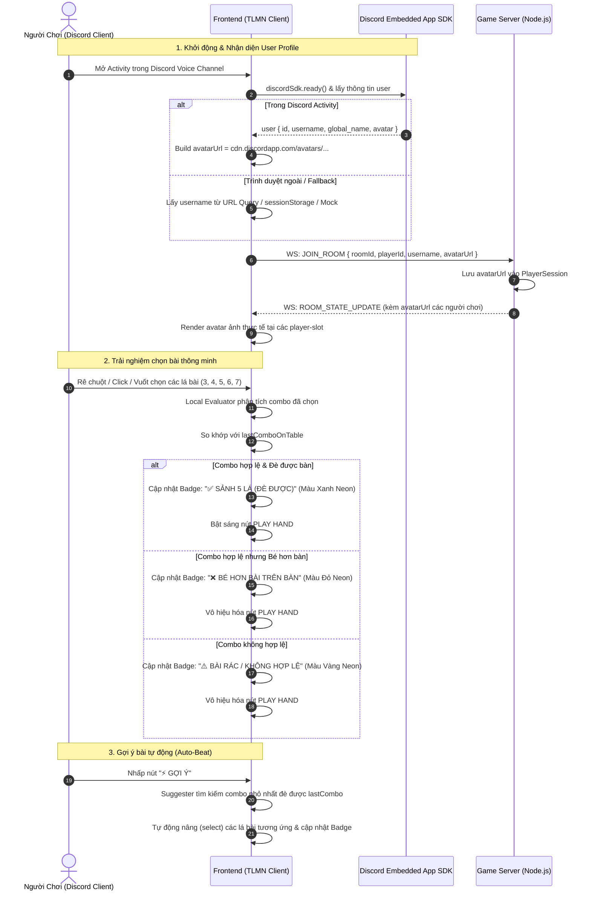

# Feature Specification: Smart Card Selection & Discord User Identity Integration

## 1. Context & Objectives
- **Bối cảnh:**
  - Game Tiến Lên Miền Nam Buff Edition (TLMN Activity) đang chạy tốt trên trình duyệt và Discord Activities (thông qua Cloudflare Tunnel).
  - Tuy nhiên, hiện tại người chơi khi vào bàn chỉ hiển thị avatar mặc định dạng emoji (`👾` cho người thật, `🤖` cho bot) và tên ngẫu nhiên (`Player_123`), chưa phản ánh avatar và nickname thật của người dùng trên Discord.
  - Về trải nghiệm tương tác (UX) chọn bài: Người chơi hiện phải nhấp thủ công từng lá bài, không có phản hồi tức thì về việc bộ bài đang chọn có hợp lệ theo luật TLMN hay không (đôi, sảnh, sám cô, tứ quý...), và có đè được bài trên bàn hay không cho đến khi bấm nút đánh và nhận thông báo lỗi. Người chơi cũng thiếu các công cụ tiện lợi như "Gợi ý bài đè được" (Auto-Beat), "Bỏ chọn tất cả" và "Kéo/vuốt chọn bài" (Drag-to-select).
- **Mục tiêu:**
  1. **Tích hợp Discord Embedded App SDK**: Tự động nhận diện tài khoản Discord của người chơi (username / global display name và avatar URL chuẩn Discord CDN `https://cdn.discordapp.com/avatars/...`). Hiển thị avatar tròn bo góc chuẩn phong cách retro pixel của từng người chơi tại các slot bàn đấu. Đồng thời giữ cơ chế fallback linh hoạt (URL params / sessionStorage) khi chạy trên trình duyệt thường.
  2. **Giao diện chọn bài thông minh (Smart Card Selection UX)**:
     - **Live Combo Validation Badge**: Hiển thị huy hiệu trực quan động ngay trên khay bài (`✅ ĐÔI 9`, `✅ SẢNH (3-7)`, `⚡ ĐÈ ĐƯỢC BÀI BÀN!`, `❌ KHÔNG ĐÈ ĐƯỢC`, `⚠️ BÀI KHÔNG HỢP LỆ`).
     - **Smart Suggestion / Auto-Beat (Nút ⚡ GỢI Ý)**: Tự động phân tích bài trên bàn và tìm bộ bài nhỏ nhất hợp lệ trên tay có thể đè được, hoặc gợi ý bộ bài mở màn khi bàn trống.
     - **Quick Deselect (Nút 🧹 BỎ CHỌN)**: Cho phép bỏ chọn toàn bộ bài đang nhấc lên chỉ với 1 click.
     - **Drag & Swipe to Select**: Cho phép rê chuột hoặc vuốt ngón tay liên tục qua nhiều lá bài để chọn/bỏ chọn nhanh chóng trên cả PC và Mobile.

---

## 2. User Stories & Interaction Flow

### 2.1. User Stories
1. **Là một người chơi trên Discord Activity**: Khi tôi khởi chạy game trong phòng Voice, tôi muốn game tự động nhận diện avatar và tên Discord của tôi, hiển thị avatar thực tế của tôi và bạn bè xung quanh bàn đấu để tăng tính cá nhân hóa và vui vẻ.
2. **Là một người chơi bài**: Khi tôi chọn các lá bài trên tay, tôi muốn biết ngay lập tức combo đó tên là gì (Đôi, Sảnh, Tứ quý...) và có đánh đè được người trước hay không, tránh việc bấm nút Play rồi mới bị báo lỗi "Nước đi không hợp lệ".
3. **Là một người chơi đang phân vân nước đi**: Tôi muốn có nút "⚡ GỢI Ý" để máy tự động chọn giúp tôi tổ hợp bài nhỏ nhất có thể chặt/đè được bài của người trước mà không cần mất công tìm kiếm từng lá.
4. **Là một người chơi trên điện thoại / cảm ứng**: Tôi muốn có thể vuốt ngón tay qua một chuỗi lá bài (ví dụ từ 3 đến 7) để nhấc cả sảnh lên một cách mượt mà thay vì phải gõ từng lá một.

### 2.2. User Interaction Flow (Mermaid Sequence Diagram)

---

## 3. Core Mechanics & Rules

### 3.1. Discord Identity Resolution Rule
1. **Kiểm tra môi trường:**
   - Nếu `window.location.search` chứa `frame_id` hoặc `instance_id` (chạy trong iframe Discord Activity) $\rightarrow$ Khởi tạo `DiscordSDK`.
   - Lấy `currentUser`:
     - Nếu có access token / auth: Lấy `user.id`, `user.global_name || user.username`, `user.avatar`.
     - Đường dẫn avatar:
       - Có avatar hash: `https://cdn.discordapp.com/avatars/${user.id}/${user.avatar}.png?size=128`.
       - Không có avatar hash: `https://cdn.discordapp.com/embed/avatars/${(BigInt(user.id) >> 22n) % 6n}.png`.
   - **Môi trường Test / Trình duyệt thường (Fallback):**
     - Cho phép truyền qua query: `?username=NguyenVanA&avatar=https://...`.
     - Nếu không có: dùng `sessionStorage` cố định kết hợp avatar hoạt hình pixel art mặc định.

### 3.2. Realtime Combo Evaluation & Feedback Rule
Mỗi khi mảng lá bài đang chọn (`selectedCardIds`) thay đổi (thêm, bớt, hoặc xóa hết):
1. **Nếu không chọn lá nào:**
   - Ẩn Combo Badge. Nút `PLAY HAND` ở trạng thái `disabled`. Nút `BỎ CHỌN` ẩn hoặc `disabled`.
2. **Nếu chọn $\ge 1$ lá:**
   - Gọi `evaluateCombo(selectedCards)`:
     - `SINGLE`: "LÁ LẺ [Rank]"
     - `PAIR`: "ĐÔI [Rank]"
     - `TRIPLE`: "SÁM CÔ [Rank]"
     - `STRAIGHT`: "SẢNH [Độ dài] LÁ ([Min] ➔ [Max])"
     - `FOUR_OF_A_KIND`: "TỨ QUÝ [Rank] 💣"
     - `THREE_PAIR_STRAIGHT`: "3 ĐÔI THÔNG ⚡"
     - `FOUR_PAIR_STRAIGHT`: "4 ĐÔI THÔNG 💥"
     - `INVALID`: "BÀI KHÔNG HỢP LỆ"
   - **So khớp với bàn (`lastComboOnTable`):**
     - Nếu đang tự do đi đầu (bàn trống): Mọi combo hợp lệ đều được đánh $\rightarrow$ Trạng thái `VALID_PLAY`.
     - Nếu trên bàn đã có bài:
       - Gọi `canBeatCombo(selectedCombo, lastComboOnTable)`.
       - Nếu đè được $\rightarrow$ Trạng thái `BEAT_SUCCESS` (Huy hiệu xanh, nút Play sáng).
       - Nếu không đè được $\rightarrow$ Trạng thái `CANNOT_BEAT` (Huy hiệu đỏ cảnh báo, nút Play tắt).

### 3.3. Smart Suggestion (Gợi ý tự động)
- Khi người chơi bấm nút `⚡ GỢI Ý` (hoặc phím tắt):
  - Nếu `!lastComboOnTable` (lượt mở màn / bàn trống):
    - Gợi ý sảnh dài nhất hoặc đôi nhỏ nhất hoặc lá lẻ nhỏ nhất trên tay để dọn bài.
  - Nếu `lastComboOnTable` đang hiện diện:
    - Tìm tổ hợp bài cùng loại nhỏ nhất trên tay đè được nó (dùng thuật toán Bot / Suggester).
    - Nếu bài trên bàn là Heo hoặc Đôi Heo: Ưu tiên tìm hàng (3 đôi thông, tứ quý, 4 đôi thông) nếu có; nếu không có thì tìm Heo to hơn; nếu không có thì thông báo "Không có bài đè được!".
    - Bỏ chọn các lá hiện tại và nhấc các lá bài vừa tìm được lên.

### 3.4. Swipe / Drag Selection (Kéo chọn hàng loạt)
- Khi người chơi giữ chuột trái hoặc ngón tay và kéo ngang qua các lá bài:
  - Sự kiện `pointerdown` trên lá bài bắt đầu chế độ drag.
  - Các lá bài nằm dưới tọa độ con trỏ (`pointermove` / `elementFromPoint`) sẽ được đánh dấu chọn.
  - Sự kiện `pointerup` kết thúc chuỗi chọn và cập nhật combo badge một lần duy nhất, tránh lag giật.

---

## 4. UI/UX Requirements
1. **Player Avatar Display:**
   - Thay thế emoji tĩnh bằng thẻ `` lồng trong khung `.avatar.pixel-box`.
   - Viền khung avatar giữ nguyên hiệu ứng phát sáng Neon CRT và vòng tròn đếm ngược thời gian (`radial-timer-svg`).
   - Nếu ảnh avatar bị lỗi (onerror) hoặc không có, tự động chuyển về fallback emoji (`👾` cho user, `🤖` cho bot).
2. **Combo Preview Badge:**
   - Nằm ngay vị trí trọng tâm phía trên khay bài (`#my-hand`), dễ thấy, không che khuất bài trên tay hay bàn chơi.
   - Thiết kế retro pixel:
     - Trạng thái `Hợp lệ / Đè được`: Viền xanh lục neon `#06d6a0`, chữ phát sáng, kèm icon checkmark `✅`.
     - Trạng thái `Chặt hàng`: Viền vàng cam neon `#ffbe0b`, rung nhẹ giật nảy pixel.
     - Trạng thái `Không đè được`: Viền đỏ neon `#ef476f`, cảnh báo rõ lý do.
3. **Thanh công cụ Action Bar:**
   - Thêm nút `⚡ GỢI Ý` (màu tím/cyan Balatro).
   - Thêm nút `🧹 BỎ CHỌN` (tự động hiện/bật khi có ít nhất 1 lá bài đang được chọn).
   - Nút `PLAY HAND` chỉ sáng và có hiệu ứng nảy (clickable) khi combo thực sự hợp lệ và đè được bài.

---

## 5. Edge Cases & Error Handling
1. **Không lấy được avatar Discord (Do lỗi mạng CDN hoặc người dùng không set avatar):**
   - Tự động fallback về Discord Default Avatar dựa trên `id` người dùng hoặc emoji pixel art.
2. **Người chơi nhấp chọn bài khi chưa đến lượt mình:**
   - Vẫn cho phép người chơi chọn thử bài trên tay để xem huy hiệu combo, giúp người chơi chuẩn bị trước nước đi. Tuy nhiên nút `PLAY HAND` vẫn ở trạng thái disabled cho tới khi đến lượt chính thức.
3. **Kéo chuột ra ngoài vùng khay bài:**
   - Tự động hủy trạng thái drag mà không làm mất các lá bài đã chọn trước đó.
4. **Ván bài kết thúc hoặc đổi lượt khi đang chọn bài:**
   - Tự động reset lựa chọn bài và huy hiệu nếu chuyển sang vòng đấu mới hoặc người khác đánh bài mới.

---

## 6. Acceptance Criteria
- [x] **Discord User Identity:**
  - [x] Lấy được username / global display name thật từ Discord SDK khi chạy trong Activity.
  - [x] Lấy được avatar URL thật từ Discord CDN và render lên avatar của người chơi tại `slot-bottom`.
  - [x] Server lưu và đồng bộ avatar URL cho tất cả đối thủ khác (`slot-left`, `slot-top`, `slot-right`).
  - [x] Chạy mượt mà trên trình duyệt thông thường với fallback đầy đủ.
- [x] **Smart Card Selection:**
  - [x] Hiển thị Live Combo Validation Badge thời gian thực khi chọn bài.
  - [x] Phân biệt rõ: Hợp lệ & Đè được bàn vs Bé hơn bài bàn vs Không đúng bộ.
  - [x] Nút `PLAY HAND` được kiểm soát thông minh, ngăn chặn đánh bài sai luật.
  - [x] Nút `⚡ GỢI Ý` tự động tìm và nhấc đúng tổ hợp nhỏ nhất đè được bài bàn.
  - [x] Nút `🧹 BỎ CHỌN` hủy chọn nhanh chóng tất cả các lá bài.
  - [x] Hỗ trợ kéo chuột / vuốt ngón tay để chọn nhiều lá liên tiếp mượt mà.
- [x] **Chất lượng mã nguồn:**
  - [x] Không làm gãy bất kỳ luật chơi bài, hệ thống buff hay bot AI hiện tại.
  - [x] Vượt qua toàn bộ bộ unit test (`npm test` 54/54 passed) và build TypeScript không lỗi (`npm run build`).

