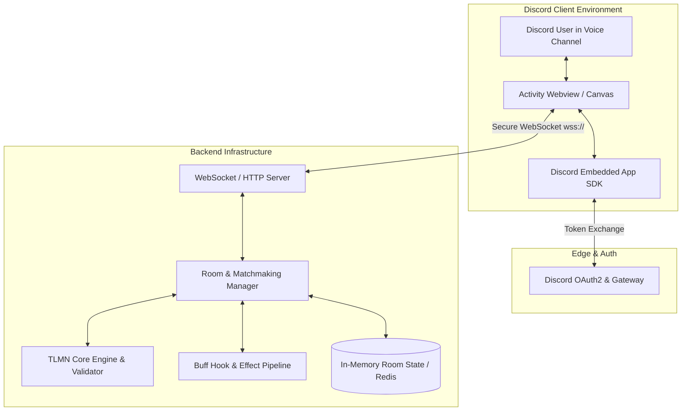
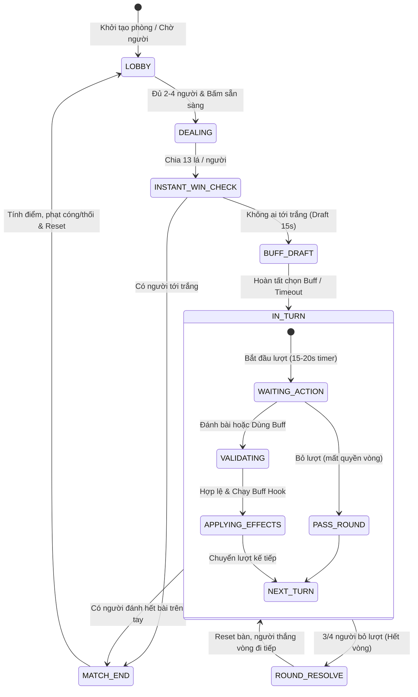
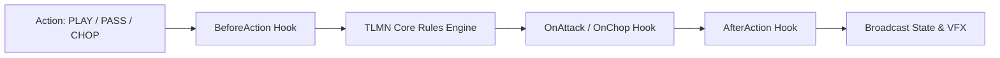

# Implementation Plan: Tiến Lên Buff (TLMN Buff Edition) - Discord Activity

> **Vai trò:** Lead Game Architect & Fullstack Engineer  
> **Trạng thái:** Chờ phê duyệt (Pending Approval)  
> **Tài liệu tham chiếu:** [`specs/system-overview.md`](../system-overview.md), [`specs/features/tien-len-buff/spec.md`](./spec.md)

---

## 1. Scope & System Architecture

### 1.1. Mô hình Discord Activity (Client Iframe + Game Server)
Trò chơi chạy dưới dạng một **Discord Activity** nhúng trực tiếp trong Voice Channel của Discord:
- **Client (Frontend)**: Chạy trong Iframe sandbox của Discord client, sử dụng **Discord Embedded App SDK** (`@discord/embedded-app-sdk`) để xác thực user, lấy avatar, nickname, voice state.
- **Reverse Proxy / Discord Mapping URL**: Discord định tuyến traffic thông qua tunnel/proxy bảo mật tới Game Server.
- **Game Server (Backend)**: Quản lý session phòng (Room Manager), duy trì WebSocket connection 2 chiều liên tục (Heartbeat/Ping-Pong), đồng bộ trạng thái thực tế.



---

### 1.2. Máy trạng thái phòng chơi (Table State Machine)
Mỗi bàn chơi (2 - 4 người) hoạt động theo một FSM (Finite State Machine) nghiêm ngặt trên Server:



---

### 1.3. Luồng bảo mật & Chống gian lận (Zero-Trust Server-Authoritative)
1. **Ẩn thông tin nhạy cảm (Data Masking)**:
   - Server tuyệt đối **không gửi toàn bộ bài của đối thủ** về client.
   - Client của Người chơi A chỉ nhận danh sách 13 lá bài của chính A. Với đối thủ B, C, D, Client A chỉ nhận `cardCount: number` và các lá bài đã được đánh công khai trên bàn.
2. **Xác thực toàn bộ ở Server (100% Server Validation)**:
   - Nước đi đánh bài (`PLAY_HAND`): Server kiểm tra bài có thực sự nằm trên tay người chơi hay không, kết hợp bài có hợp lệ và có đè được bài trên bàn hay không.
   - Thao tác Buff (`USE_BUFF`): Server kiểm tra người chơi có sở hữu buff đó không, buff còn số lần dùng (`charges > 0`) không, và điều kiện kích hoạt có thỏa mãn không.
3. **Chống giả mạo danh tính (Token Verification)**:
   - Client gửi `accessToken` từ Discord SDK; Server verify với Discord API trước khi gán socket vào `PlayerSession`.

---

## 2. Data Contracts & Event Schema

### 2.1. Thực thể dữ liệu (Data Entities)

```typescript
// 1. Lá bài & Chất
export enum Suit {
  SPADE = 0,   // Bích (♠)
  CLUB = 1,    // Chuồn (♣)
  DIAMOND = 2, // Rô (♦)
  HEART = 3    // Cơ (♥)
}

export enum Rank {
  THREE = 3, FOUR = 4, FIVE = 5, SIX = 6, SEVEN = 7,
  EIGHT = 8, NINE = 9, TEN = 10, JACK = 11, QUEEN = 12,
  KING = 13, ACE = 14, TWO = 15 // Heo
}

export interface Card {
  id: number;     // 0 - 51
  rank: Rank;
  suit: Suit;
  code: string;   // e.g. "3S", "2H", "10D"
}

// 2. Tổ hợp bài trên bàn
export enum ComboType {
  INVALID = 'INVALID',
  SINGLE = 'SINGLE',                           // Rác
  PAIR = 'PAIR',                               // Đôi
  TRIPLE = 'TRIPLE',                           // Sám cô
  STRAIGHT = 'STRAIGHT',                       // Sảnh (3 - 12 lá)
  THREE_PAIR_STRAIGHT = 'THREE_PAIR_STRAIGHT', // 3 đôi thông
  FOUR_OF_A_KIND = 'FOUR_OF_A_KIND',           // Tứ quý
  FOUR_PAIR_STRAIGHT = 'FOUR_PAIR_STRAIGHT'    // 4 đôi thông
}

export interface HandCombo {
  type: ComboType;
  cards: Card[];
  highestCard: Card;
  length: number;
  playedByPlayerId: string;
}

// 3. Hệ thống Buff
export type BuffRarity = 'COMMON' | 'RARE' | 'EPIC' | 'LEGENDARY';
export type BuffTriggerType = 'PASSIVE' | 'ACTIVE_ON_TURN' | 'REACTIVE_ON_ATTACK';

export interface BuffDefinition {
  id: string;                    // e.g. "BUFF_PIG_ARMOR"
  name: string;                  // e.g. "Giáp Heo"
  description: string;
  rarity: BuffRarity;
  triggerType: BuffTriggerType;
  maxCharges: number;
  icon: string;
}

export interface PlayerBuffSlot {
  buffId: string;
  remainingCharges: number;
  isActive: boolean;
}

// 4. Người chơi & Phòng
export interface PlayerState {
  id: string;                    // Socket ID / Session ID
  discordId: string;
  username: string;
  avatarUrl: string;
  seatIndex: number;             // 0 - 3
  cardCount: number;             // Công khai cho mọi client
  handCards?: Card[];            // Chỉ gửi cho chính chủ sở hữu
  buffs: PlayerBuffSlot[];       // Danh sách buff hiện có
  hasPassedRound: boolean;       // Đã bỏ lượt trong vòng hiện tại?
  isConnected: boolean;
  isReady: boolean;
  score: number;
}

export enum RoomStatus {
  LOBBY = 'LOBBY',
  DEALING = 'DEALING',
  BUFF_DRAFT = 'BUFF_DRAFT',
  PLAYING = 'PLAYING',
  MATCH_END = 'MATCH_END'
}

export interface RoomState {
  roomId: string;
  status: RoomStatus;
  players: PlayerState[];
  currentTurnSeatIndex: number;
  turnDeadlineTimestamp: number;
  lastComboOnTable: HandCombo | null;
  roundLeaderSeatIndex: number;
  freeRound: boolean;            // true nếu bắt đầu vòng mới (được đánh tự do)
  drawPileCount: number;         // Số lá bài dư trong nọc (phục vụ buff hoán bài)
}
```

---

### 2.2. Danh mục sự kiện WebSocket (Event Schema)

| Kênh Event | Chiều gửi | Payload | Mục đích |
| :--- | :---: | :--- | :--- |
| `JOIN_ROOM` | Client ➔ Server | `{ roomId: string, discordToken: string }` | Tham gia phòng chơi |
| `PLAYER_READY` | Client ➔ Server | `{ isReady: boolean }` | Sẵn sàng bắt đầu ván |
| `SELECT_BUFF` | Client ➔ Server | `{ buffId: string }` | Chọn 1 trong 3 buff khi Draft |
| `PLAY_HAND` | Client ➔ Server | `{ cardIds: number[] }` | Đánh một kết hợp bài |
| `PASS_TURN` | Client ➔ Server | `{}` | Bỏ lượt trong vòng hiện tại |
| `USE_BUFF` | Client ➔ Server | `{ buffId: string, targetSeatIndex?: number, extraParams?: any }` | Kích hoạt Buff chủ động |
| `ROOM_STATE_UPDATE` | Server ➔ Client | `{ roomState: Partial<RoomState> }` | Đồng bộ tổng thể trạng thái bàn chơi |
| `DEAL_CARDS` | Server ➔ Client | `{ yourCards: Card[], drawPileCount: number }` | Chia bài riêng cho từng client |
| `BUFF_DRAFT_START` | Server ➔ Client | `{ options: BuffDefinition[], timeoutMs: number }` | Mở màn hình chọn 3 buff ngẫu nhiên |
| `BUFF_ACTIVATED` | Server ➔ Client | `{ sourceSeatIndex: number, buffId: string, effectDescription: string }` | Broadcast hiệu ứng buff cho cả phòng xem |
| `HAND_PLAYED` | Server ➔ Client | `{ seatIndex: number, combo: HandCombo, remainingCardsCount: number }` | Thông báo có nước đi mới trên bàn |
| `ROUND_CLEARED` | Server ➔ Client | `{ newRoundLeaderSeatIndex: number }` | Hết vòng, xóa bàn, reset lượt |
| `MATCH_FINISHED` | Server ➔ Client | `{ rankings: { seatIndex: number, scoreDelta: number, isCong: boolean }[] }` | Kết thúc ván, tổng kết điểm |
| `ERROR_EVENT` | Server ➔ Client | `{ code: string, message: string }` | Báo lỗi khi nước đi không hợp lệ |

---

## 3. Core Engine: TLMN & Buff Pipeline

### 3.1. Thuật toán thẩm định nước đi TLMN (Core Validator)
1. **Phân loại kết hợp bài (`evaluateCombo`)**:
   - `SINGLE`: 1 lá bài.
   - `PAIR`: 2 lá cùng rank.
   - `TRIPLE`: 3 lá cùng rank.
   - `STRAIGHT`: $\ge 3$ lá liên tiếp về rank, **tuyệt đối không chứa 2 (Heo)**.
   - `THREE_PAIR_STRAIGHT`: 3 cặp đôi liên tiếp, không chứa Heo.
   - `FOUR_OF_A_KIND`: 4 lá cùng rank.
   - `FOUR_PAIR_STRAIGHT`: 4 cặp đôi liên tiếp, không chứa Heo.
2. **Quy tắc đè bài & Chặt hàng (`canBeatCombo`)**:
   - *Đánh bình thường*: Cùng `ComboType` và cùng `length`, so sánh `highestCard` theo rank, nếu bằng rank so tiếp theo chất (`♠ < ♣ < ♦ < ♥`).
   - *Luật chặt Heo đơn*:
     - Heo lớn hơn đè heo bé (`2♥ > 2♦ > 2♣ > 2♠`).
     - Chặt được bởi: **3 đôi thông**, **Tứ quý**, **4 đôi thông**.
   - *Luật chặt Đôi Heo*:
     - Chặt được bởi: **Tứ quý**, **4 đôi thông**.
   - *Luật chặt 3 đôi thông*:
     - Chặt được bởi: 3 đôi thông lớn hơn, Tứ quý, 4 đôi thông.
   - *Luật chặt Tứ quý*:
     - Chặt được bởi: Tứ quý lớn hơn, 4 đôi thông.
   - *Luật chặt 4 đôi thông*:
     - Chặt được 4 đôi thông nhỏ hơn (và chặt được bất kỳ lúc nào mà không cần chờ tới vòng của mình).
3. **Các trạng thái kết thúc đặc biệt**:
   - **Tới Trắng (Instant Win)**: Kiểm tra ngay sau khi chia bài:
     - Sảnh rồng ($3 \to A$).
     - Tứ quý Heo ($2♠\ 2♣\ 2♦\ 2♥$).
     - 5 hoặc 6 đôi bất kỳ.
     - Đồng chất (13 lá cùng đỏ hoặc cùng đen).
   - **Cóng (Cháy bài)**: Một người chơi về nhất trong khi có người chơi khác chưa đánh ra được bất kỳ một lá bài nào. Người bị cóng bị trừ gấp đôi điểm phạt và kiểm tra thối heo/hàng.
   - **Thối Heo / Thối Hàng**: Các lá 2 hoặc hàng (3 đôi thông, tứ quý, 4 đôi thông) còn sót lại trên tay người thua cuộc khi ván kết thúc.

---

### 3.2. Hệ thống Buff Hook & Interceptor Pipeline
Buff được gắn vào vòng đời Game Engine dưới dạng Interceptors để thay đổi luật bài mà không làm phá vỡ logic gốc:



- **`BeforePlayHandHook`**: 
  - Ví dụ: `BUFF_SWAP_CARD` (Hoán bài): Cho phép người chơi bỏ 1 lá rác trên tay vào discard pile và rút 1 lá từ cọc dự phòng `drawPile` trước khi chọn bài đánh.
  - Ví dụ: `BUFF_SPY_HAND` (Mắt thần): Trả về payload riêng chứa 2 lá bài ngẫu nhiên của người tiếp theo.
- **`OnChopHook (Reaction Interceptor)`**:
  - Khi một người chơi chặt heo/hàng của người khác:
    - Nếu nạn nhân có `BUFF_PIG_ARMOR` (Giáp heo): Miễn trừ lần chặt đầu tiên từ 3 đôi thông hoặc giảm 50% tiền phạt.
    - Nếu nạn nhân có `BUFF_REFLECT_CUT` (Gương phản xạ): Phản lại 50% số tiền phạt sang cho người vừa thực hiện chặt.
- **`OnPassTurnHook`**:
  - Nếu người chơi có `BUFF_REVIVE_PASS` (Tái sinh lượt): Đánh dấu cờ đặc biệt, cho phép họ tiếp tục tham gia chặt ở các lượt tiếp theo của cùng một vòng chơi thay vì bị khóa quyền đến hết vòng.

---

## 4. Step-by-Step Task Checklist (Phân rã công việc)

### Phase 1: Project Setup & Networking Scaffolding
- [x] Khởi tạo Monorepo / thư mục chuẩn cho cả Server (Node.js/TypeScript) và Client.
- [x] Thiết lập WebSocket Server (sử dụng `ws`) với heartbeat ping/pong và cấu trúc quản lý Room.
- [x] Thiết lập cơ chế mock Discord SDK phục vụ môi trường phát triển local trên trình duyệt thông thường.
- [x] Viết integration test cho WebSocket Gateway (Zero-trust card masking).

### Phase 2: Core TLMN Engine (Server-side)
- [x] Xây dựng bộ bài chuẩn 52 lá (`deck.ts`): cơ chế xáo bài ngẫu nhiên (Fisher-Yates) và thuật toán chia 13 lá.
- [x] Cài đặt thuật toán nhận diện kết hợp bài TLMN (`evaluator.ts`): Rác, Đôi, Sám, Sảnh, 3 đôi thông, Tứ quý, 4 đôi thông.
- [x] Xây dựng logic thẩm định đè bài (`canBeatCombo`) chuẩn luật TLMN (luật đè bài thông thường & ma trận chặt Heo/Hàng).
- [x] Xây dựng bộ kiểm tra Tới Trắng ngay sau chia bài (Sảnh rồng, Tứ quý heo, 6 đôi...).
- [x] Cài đặt bộ tính phạt kết thúc ván: Phạt Cóng, phạt Thối Heo (Heo đen, Heo đỏ), Thối Tứ quý/Đôi thông.
- [x] Viết bộ Unit Tests toàn diện cho Core Engine (Đã hoàn thành 18/18 test cases).

### Phase 3: Buff System Implementation
- [x] Thiết kế `BuffRegistry` định nghĩa danh mục các thẻ Buff (Passive, Active, Reactive) và chỉ số hiệu ứng.
- [x] Xây dựng Phase `BUFF_DRAFT`: Tạo danh sách 3 thẻ ngẫu nhiên cho mỗi người chơi khi ván bắt đầu.
- [x] Cài đặt `BuffManager` với các Hook:
  - [x] `Hook: BeforePlayHand` (`BUFF_SWAP_CARD`, `BUFF_SPY_HAND`).
  - [x] `Hook: OnChopReaction` (`BUFF_PIG_ARMOR`, `BUFF_REFLECT_CUT`).
  - [x] `Hook: OnPassTurn` (`BUFF_REVIVE_PASS`).
  - [x] `Hook: OnRoundStart` (`BUFF_FIRST_STRIKE`).
- [x] Viết Unit Test cho từng Buff Effect và các trường hợp xung đột hiệu ứng (Đã hoàn thành 6/6 test cases).

### Phase 4: Game Client UI & Audio
- [x] Xây dựng bàn chơi 4 vị trí (Bottom, Left, Top, Right) hiển thị avatar và số lượng bài của đối thủ.
- [x] Thiết kế vùng bài của người chơi (Hand Tray): Hỗ trợ click chọn bài, nâng bài lên (`translateY`), sắp xếp bài theo Rank hoặc theo Chất.
- [x] Thiết kế `BuffTray` (Khay hiển thị thẻ buff): Hiển thị icon, khung màu phẩm cấp (Common -> Legendary) và số lần sử dụng.
- [x] Xây dựng Modal "Chọn Buff đầu trận" (Draft Phase) với 3 thẻ kỹ năng ngẫu nhiên.
- [x] **Smart Auto-Suggest Combo**: Tự động nhận diện dạng bài người đi trước (Đôi, Sám, Sảnh K lá, 3 đôi thông, Tứ quý) và tự chọn đủ các lá còn lại khi nhấp 1 lá.
- [x] **Web Audio API Sound Synthesizer**: Tích hợp âm thanh click chọn bài, quăng bài, chặt đè (Heavy Boom), kích hoạt Buff, bỏ lượt và nút bật/tắt âm thanh (Mute).
- [x] **VFX Animation**: Hiệu ứng rung lắc bàn chơi (Screen Shake) và banner pop-up khi chặt Heo/Hàng.

### Phase 5: Edge Cases & Testing
- [x] Xử lý ngắt kết nối (Disconnect): Đặt cờ `isConnected = false`, giữ nguyên vị trí ngồi trong thời gian chờ (Reconnection Window: 30s).
- [x] Tự động chuyển lượt (Auto-pass) hoặc đánh lá nhỏ nhất khi hết thời gian đếm ngược 15s (`handleTurnTimeout`).
- [x] Cơ chế khôi phục trạng thái (`RECONNECT` / `reconnectPlayer`): Khôi phục session và tiếp tục ván đấu.
- [x] Xử lý ngoại lệ hết cọc bài nọc khi sử dụng `BUFF_SWAP_CARD`.
- [x] **Match End & Scoreboard Loop**: Tính điểm phạt cóng/thối heo/hàng, hiển thị modal vinh danh và nút `Chơi Ván Mới` reset bàn về Lobby.
- [x] Toàn bộ 33 Unit Tests tự động đạt 100%.
