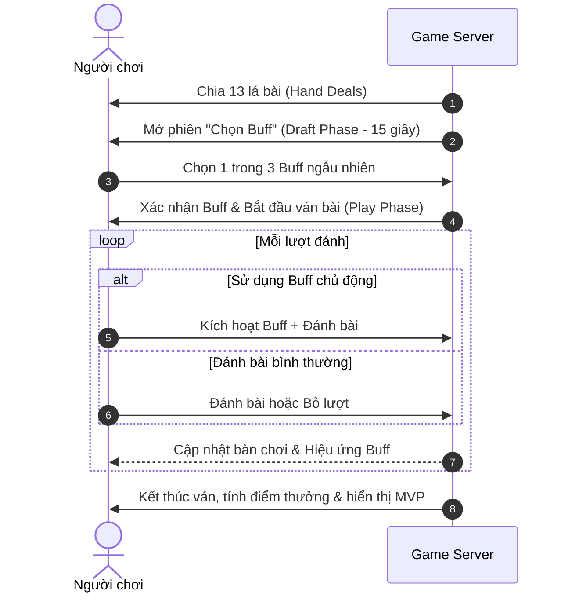

# Feature Spec: Tiến Lên Buff (TLMN Buff Edition)

## 1. Giới thiệu & Mục tiêu (Context & Objectives)

**Tiến Lên Buff** là chế độ chơi cải tiến từ luật Tiến Lên Miền Nam truyền thống, tích hợp các yếu tố Roguelike / RPG (Buff Cards / Kỹ năng kích hoạt). 

### Mục tiêu:
- Tạo sự đột biến trong từng ván bài, biến các ván bài xấu thành cơ hội lội ngược dòng.
- Tăng tính chiến thuật và tương tác trực tiếp giữa các người chơi trong phòng.
- Giữ được bản sắc cân bằng của TLMN: kỹ năng tính bài vẫn là cốt lõi, buff là yếu tố bổ trợ và tạo đột biến.

---

## 2. Luồng ván đấu (Match Flow)

---

## 3. Hệ thống Buff (Buff Categories & Mechanics)

Mỗi người chơi có tối đa **1 - 2 ô Buff Slot** trong mỗi ván bài. Buff được chia thành 3 nhóm cơ bản:

### A. Buff Bị Động (Passive Buffs) - Kích hoạt tự động khi đạt điều kiện
| Mã Buff | Tên Buff | Phẩm cấp | Tác dụng |
| :--- | :--- | :--- | :--- |
| `BUFF_PIG_ARMOR` | **Giáp Heo (Pig Armor)** | Hiếm (Rare) | Lá 2 (Heo) đầu tiên bị chặt sẽ chỉ tính phạt 50% tiền cược hoặc miễn 1 lần bị 3 đôi thông chặt. |
| `BUFF_FIRST_STRIKE` | **Tiên Thủ (First Strike)** | Thường (Common) | Được ưu tiên đi đầu ván bài mà không phụ thuộc vào 3 Bích (nếu nhiều người có, random giữa những người đó). |
| `BUFF_REVIVE_PASS` | **Tái Sinh Lượt (Second Wind)** | Sử thi (Epic) | Khi bỏ lượt 1 lần, vẫn được giữ quyền đánh ở các vòng tiếp theo của cùng bộ bài đó. |

### B. Buff Chủ Động (Active Buffs) - Người chơi ấn nút kích hoạt trong lượt của mình
| Mã Buff | Tên Buff | Thời điểm dùng | Tác dụng |
| :--- | :--- | :--- | :--- |
| `BUFF_SWAP_CARD` | **Hoán Bài (Card Transmute)** | Trước khi đánh bài | Bỏ 1 lá bài rác bất kỳ trên tay để rút ngẫu nhiên 1 lá bài mới từ cọc dự phòng. |
| `BUFF_SPY_HAND` | **Mắt Thần (Clairvoyance)** | Bất kỳ lúc nào trong lượt | Soi được 2 lá bài ngẫu nhiên trên tay của người kế tiếp. |
| `BUFF_FREEZE_TURN` | **Băng Phong (Turn Freeze)** | Khi bị người trước chặn | Khiến người tiếp theo bắt buộc phải bỏ lượt (Skip turn). |

### C. Buff Phản Đòn (Reactive Buffs) - Tự động hoặc ấn kích hoạt khi bị tấn công
| Mã Buff | Tên Buff | Tác dụng |
| :--- | :--- | :--- |
| `BUFF_REFLECT_CUT` | **Gương Phản Xạ (Reflect Cut)** | Khi bị chặt heo/hàng, chuyển 50% tiền phạt cho người chặt. |

---

## 4. Giao diện & Trải nghiệm người dùng (UI/UX)

1. **Khay Buff (Buff Tray)**:
   - Nằm ngay phía trên hoặc góc phải cạnh bài trên tay của người chơi.
   - Hiển thị Icon buff, viền màu theo độ hiếm (Xám: Common, Lam: Rare, Tím: Epic, Vàng: Legendary).
   - Có trạng thái Cooldown / Số lần sử dụng còn lại (Uses count).
2. **Hiệu ứng kích hoạt (VFX/SFX)**:
   - Khi kích hoạt buff, có hiệu ứng hào quang phóng lên bàn chơi, kèm âm thanh đặc trưng.
   - Thông báo dạng pop-up nhanh giữa màn hình: `"[Player 1] đã kích hoạt: Mắt Thần!"`.

---

## 5. Quy tắc xử lý ngoại lệ (Edge Cases)

1. **Xung đột Buff đồng thời**: Nếu 2 buff khắc chế lẫn nhau được kích hoạt (ví dụ: Chặn lượt vs Kháng hiệu ứng), thứ tự ưu tiên là Buff phòng thủ > Buff tấn công.
2. **Tới Trắng (Instant Win)**: Tới trắng được tính ngay sau khi chia bài, **trước khi** bước vào giai đoạn Chọn Buff. Nếu có người tới trắng, phase Buff sẽ bị bỏ qua.
3. **Mất kết nối (Disconnect) trong lúc Chọn Buff**: Nếu đếm ngược hết giờ mà người chơi chưa chọn, Server sẽ tự động chọn ngẫu nhiên 1 buff cho người chơi đó.
4. **Hết bài cọc rút (Empty Draw Pile)**: Đối với buff Hoán Bài, nếu kho bài thừa rỗng, buff sẽ hoàn trả lượt dùng và hiển thị thông báo lỗi thân thiện.

---

## 6. Tiêu chí nghiệm thu (Acceptance Criteria)

- [ ] Người chơi nhận được 3 lựa chọn buff ngẫu nhiên ở đầu ván đấu.
- [ ] Server kiểm tra và thực thi chính xác tác dụng của từng loại buff (Passive, Active, Reactive).
- [ ] Giao diện Client thể hiện đầy đủ trạng thái buff của bản thân và thông tin buff công khai của đối thủ.
- [ ] Không thể can thiệp Client để gian lận buff (Server validate hoàn toàn).
- [ ] Log sự kiện buff được ghi lại đầy đủ cho mục đích debug và hiển thị lịch sử ván bài.

