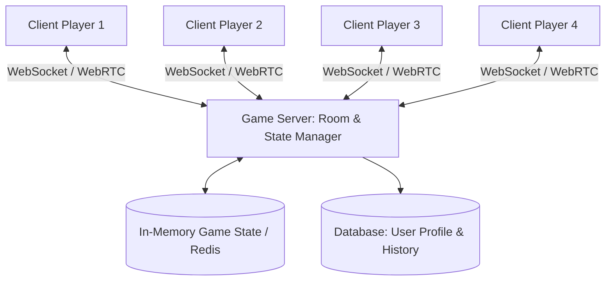

# System Overview - TLMN Activity

## 1. Giới thiệu tổng quan (Introduction)
**TLMN Activity** là phiên bản số hóa của trò chơi dân gian bài **Tiến Lên Miền Nam** (Việt Nam), được thiết kế tối ưu hóa cho nền tảng Web / Embedded Activity (như Discord Activities, Telegram Mini Apps hoặc Web Mobile). 

Hệ thống kết hợp luật chơi truyền thống với các cơ chế hiện đại (đặc biệt là hệ thống **Buff / Thẻ kỹ năng**) nhằm tăng tính tương tác, kịch tính và giá trị chơi lại (replayability).

---

## 2. Kiến trúc tổng quan (Architecture Overview)

Mô hình hệ thống vận hành theo cơ chế **Server-Authoritative** (Server làm chủ hoàn toàn logic và trạng thái, Client chỉ render và gửi action) để chống gian lận (anti-cheat).



### Thành phần chính:
1. **Client (Frontend)**:
   - Hiển thị bàn chơi, hoạt họa chia bài, đánh bài, chọn buff và hiệu ứng VFX.
   - Nhận trạng thái `GameState` từ Server để đồng bộ giao diện.
   - Chỉ được biết bài trên tay của chính mình (thông tin bài của người khác được ẩn/che giấu từ phía Server).
2. **Server (Backend)**:
   - **Matchmaking & Room Management**: Ghép phòng (2 - 4 người chơi), quản lý vòng đời phòng chơi.
   - **Game Engine (TLMN Core)**: Trộn bài (Shuffling), chia bài (Dealing), kiểm tra tính hợp lệ của bài đánh ra (Card validation), tính điểm, xác định người thắng/thua.
   - **Buff Engine**: Quản lý vòng đời buff, điều kiện kích hoạt, hiệu lực và giải quyết xung đột khi có nhiều buff cùng tác động.
   - **Turn & Timer Manager**: Quản lý đồng hồ đếm ngược từng lượt (Turn timer, Disconnect timeout).

---

## 3. Tech Stack khuyến nghị

| Tầng | Công nghệ gợi ý | Vai trò |
| :--- | :--- | :--- |
| **Frontend** | TypeScript, React / Vue + Pixi.js hoặc Phaser 3 | Render bàn bài mượt mà, hỗ trợ tốt đa kích thước màn hình |
| **Backend** | Node.js (TypeScript) / Colyseus / Bun | Xử lý real-time state synchronization, match session |
| **Giao thức** | WebSocket (hoặc Colyseus protocol) | Giao tiếp 2 chiều độ trễ thấp giữa Client và Server |
| **Storage / Caching** | Redis + PostgreSQL / MongoDB | Lưu trữ cache room tạm thời và thông tin user/inventory |

---

## 4. Quy ước dữ liệu bài chuẩn (Card Data Convention)

- **Bộ bài tiêu chuẩn**: 52 lá (bỏ Joker).
- **Giá trị chất (Suit Rank)**: Bích (♠) < Chuồn/Tép (♣) < Rô (♦) < Cơ (♥).
- **Giá trị số (Card Rank)**: 3 < 4 < 5 < ... < 10 < J < Q < K < A < 2 (Heo).
- **Mã hóa lá bài (Card ID)**: 
  - Đánh số từ 0 đến 51, hoặc object `{ rank: 3..15, suit: 'spade' | 'club' | 'diamond' | 'heart' }`.
  - Ví dụ: 3 Bích là lá nhỏ nhất, 2 Cơ là lá lớn nhất trong bộ bài cơ bản.

---

## 5. Cấu trúc thư mục Specs

Dự án áp dụng mô hình **Spec-Driven Development**:
```text
specs/
├── system-overview.md              # Kiến trúc hệ thống & quy ước toàn cục
└── features/                       # Mỗi feature là 1 folder độc lập
    └── tien-len-buff/              # Chế độ Tiến Lên kết hợp cơ chế Buff
        ├── spec.md                 # Đặc tả nghiệp vụ & Luật chơi (What & Why)
        └── plan.md                 # Kế hoạch kỹ thuật, Schema & Tasks (How)
```

